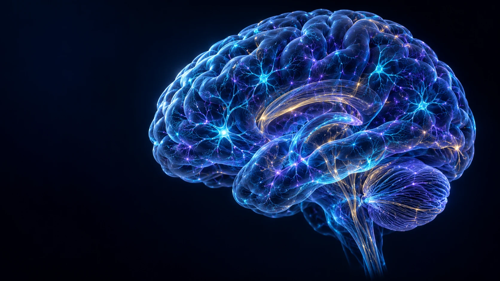

  <header class="portfolio-nav">
    <a class="brand" href="#home" aria-label="Armin Abdollahi home"><svg viewBox="0 0 48 48"><path d="M24 8c-4-5-12-2-12 4-6 1-7 9-2 12-4 5-1 12 5 12 2 6 8 6 11 2M24 8c4-5 12-2 12 4 6 1 7 9 2 12 4 5 1 12-5 12-2 6-8 6-11 2M24 8v30M16 13l6 5-6 5m16-10-6 5 6 5m-18 8 7-5m14 5-7-5"/></svg><b>ARMIN ABDOLLAHI</b><small>NEURAL DECODING & BCI</small></a>
    <nav aria-label="Main navigation"><a class="is-current" href="#home">Home</a><a href="#research">Research</a><a href="#publications">Publications</a><a href="/cv/">CV</a><a href="https://scholar.google.com/citations?user=_lXpoGEAAAAJ&amp;hl=en" target="_blank" rel="noopener">Scholar ↗</a><a href="https://github.com/Armin-Abdollahi" target="_blank" rel="noopener">GitHub ↗</a><a href="#contact">Contact</a></nav>
    BCI <i>·</i> EEG <i>·</i> AI
    <button class="nav-menu" type="button" aria-label="Toggle navigation" aria-expanded="false"></button>
  </header>

  <main>
    <section class="hero-dashboard" aria-labelledby="hero-title">
      

        
 RESEARCHER & ENGINEER / TEHRAN, IRAN

        <h1 id="hero-title">Decoding cortical dynamics with AI.</h1>
        
I’m Armin Abdollahi. I work across <strong>brain–computer interfaces, EEG and artificial intelligence</strong>—with a focus on how neural signals become meaningful human–computer interaction.

        
<i class="specialty-icon icon-brain">⌘</i> BCI<i class="specialty-icon icon-wave">∿</i> EEG<i class="specialty-icon icon-ai">✳</i> Deep Learning<i class="specialty-icon icon-network">⠿</i> HCI

        
<a href="#research" class="action-primary">Explore my work ↘</a><a href="mailto:armin.abdollahi.64@gmail.com" class="action-secondary">Contact me ↗</a>

      

      

        
        <canvas class="brain-webgl" aria-hidden="true"></canvas>
        

        

        C3 <i></i>Cz <i></i>C4 <i></i>
        
NEURAL NETWORK<b>LIVE MODEL</b>

        
⌁<b>EEG signal flow</b><small>interactive 3D visualization</small>

        SCROLL TO EXPLORE ↓
      

      <aside class="signal-panel" aria-label="Illustrative EEG signal panel">
        
<i class="mini-wave">∿</i> EEG SIGNAL VIEW•••

        

<i></i><i></i><i></i><i></i><i></i><i></i><i></i><i></i><i></i><i></i><i></i><i></i><b></b>

Illustrative view<b><i class="legend-dot dot-cyan"></i> Neural activity</b><b><i class="legend-dot dot-violet"></i> Signal variation</b><small>Not experimental data</small>

        

        
NEURAL SIGNALILLUSTRATIVE · EEG

        

+0−
<svg viewBox="0 0 460 120" preserveAspectRatio="none" role="img" aria-label="Animated illustrative EEG signal waveform"><defs><linearGradient id="wave-cyan" x1="0" x2="1"><stop stop-color="#31c8ff"/><stop offset="1" stop-color="#7a8dff"/></linearGradient><linearGradient id="wave-purple" x1="0" x2="1"><stop stop-color="#a15cff"/><stop offset="1" stop-color="#37dfff"/></linearGradient></defs><path class="wave-path wave-one" d="M0 56 C18 50 24 52 35 56 S51 80 62 61 S78 37 87 57 S100 78 111 55 S125 30 136 55 S148 84 162 57 S178 40 189 59 S203 78 215 53 S231 28 241 57 S255 83 267 59 S282 34 294 57 S308 79 320 54 S337 41 348 57 S362 69 375 56 S390 47 402 58 S430 70 460 55"/><path class="wave-path wave-two" d="M0 70 C20 72 24 59 38 68 S56 88 68 71 S81 49 94 68 S109 84 120 70 S139 55 150 68 S166 91 179 71 S195 54 207 69 S222 88 234 71 S253 51 266 69 S281 86 294 71 S310 56 325 69 S341 84 355 70 S375 57 387 69 S415 84 460 70"/></svg>

        
0s1s2s3s4s

        
Concept visualization · no patient or research data

      </aside>

      
NEURAL SIGNALS <i>✳</i> INTELLIGENT SYSTEMS <i>✳</i> HUMAN-CENTERED DESIGN01 <b>—</b> 05

    </section>

    <section class="facts-ribbon" aria-label="Academic profile at a glance">
      <article class="fact-item">◉
<b>3</b><small>research papers</small>
1 accepted · 1 under review 1 in preparation</article>
      <article class="fact-item">⌂
<b>20/20</b><small>master’s thesis defense</small>
Artificial Intelligence University of Tehran</article>
      <article class="fact-item">⌘
<b>Founder</b><small>SyncNeurons</small>
CEO & Chief Architect Neurotechnology platform</article>
      <article class="fact-item fact-link">↗
<b>Explore</b><small>selected projects</small>
<a href="#projects" aria-label="Explore selected projects">View work →</a></article>
    </section>

    <section class="research-section section-wrap" id="research">
      

01 / RESEARCH & INTERESTS
<h2>Brains, signals and interaction.</h2>

My work asks how we can build neural interfaces that are useful to people, grounded in signal processing and thoughtful about the limits of machine learning.

      

        <article class="research-card">
01EEG → ACTION<i>↗</i>

MIC3CzC4
<h3>Motor imagery</h3>
Subject-independent decoding, model comparisons and the signal features that may help BCI systems generalize across people.

BCIEEGDeep learning
</article>
        <article class="research-card">
02EEG → LANGUAGE<i>↗</i>

<i></i><i></i><i></i><i></i><i></i><i></i><i></i><i></i><i></i><i></i><i></i><i></i><i></i><i></i><i></i><i></i><i></i><i></i><i></i><i></i><i></i><i></i><i></i>
[ <b>speech</b> ]
<h3>Imagined speech</h3>
Exploring non-invasive neural signals for silent communication, with care around signal quality and what a model can establish.

Speech BCISignal processingXAI
</article>
        <article class="research-card">
03PERSON ↔ SYSTEM<i>↗</i>

●AI↗↙
<h3>Human–computer interaction</h3>
Human-centered neurotechnology: how adaptive systems should respond to context, people and uncertainty.

HCIAdaptive systemsNeurotechnology
</article>
      

    </section>

    <section class="projects-section section-wrap" id="projects">
      

02 / SELECTED WORK
<h2>Research in practice. Systems for people.</h2>
<a href="/projects/" class="section-link">All projects ↗</a>

      

        <article class="project-tile sync-tile">
NEUROTECH PLATFORM01 / 03

<i></i><i></i><i></i><b>SN</b>
<small>CONNECT <i>·</i> PROCESS <i>·</i> INTERACT</small>

FOUNDER · CEO · CHIEF ARCHITECT
<h3>SyncNeurons</h3>
Leading platform strategy and core neural-network architecture, with a focus on real-time EEG processing, explainable AI and zero-trust data architecture.
<a href="https://syncneurons.com/" target="_blank" rel="noopener">Explore SyncNeurons ↗</a>
</article>
        <article class="project-tile">
APPLIED EEG / EMOTIV02 / 03

SIGNAL <i>→</i> ANALYSIS <i>→</i> REPORT<svg viewBox="0 0 620 140" aria-hidden="true"><path d="M0 70h60l10-5 12 14 12-42 14 78 12-95 14 80 14-30 13 10h70l14-6 13 12 12-43 15 77 13-95 14 81 14-31 12 11h67l12-5 13 14 12-41 14 75 14-97 12 83 12-33 15 10h68l12-6 12 14 14-43 13 77 12-96 13 81 14-32 14 11h69"/></svg>EEG · INTERACTIVE REPORTING

WHITE TREE INTERNATIONAL ACADEMY
<h3>Automated EEG analysis</h3>
Built an Emotiv EEG analysis and reporting workflow with signal processing, machine learning, Python backend and interactive dashboard.
<a href="/projects/#eeg-analytics">Project details ↗</a>
</article>
        <article class="project-tile">
COGNITIVE INTERACTION03 / 03

01

02

03

PLAY <i>↔</i> LEARN
INTERACTIVE TASKS · PERFORMANCE INSIGHTS

DESIGN · SOFTWARE · ANALYTICS
<h3>Cognitive assessment games</h3>
Designed interactive memory, attention and reaction-time games with Python-based performance analysis and reports.
<a href="/projects/#cognitive-games">Project details ↗</a>
</article>
      

      
ⓘ Applied projects are described by scope and implementation; they are not presented as clinically validated diagnostic tools.

    </section>

    <section class="publications-section section-wrap" id="publications">
      

03 / SCHOLARLY WORK
<h2>Three papers. Accurate status.</h2>

The list reflects current manuscript stages. The imagined-speech paper is still in preparation and has not been submitted.

      

        <article class="publication-row">01
UNDER REVIEW · MAJOR REVISION<h3>A Comparative Study on Convolutional and Transformer Architectures for Subject-Independent Motor Imagery Decoding</h3>
Armin Abdollahi, Maliheh Sabeti, Reza Boostani
<small>Journal of Neuroscience Methods · Elsevier</small>
↗</article>
        <article class="publication-row">02
IN PREPARATION · NOT YET SUBMITTED<h3>NSG-Net; A Neurospectral-Graph Network for Imagined Speech Decoding and Few-Shot Personalization</h3>
Sarina Kasaiyan, Armin Abdollahi, Maliheh Sabeti, Reza Boostani, Saeid Sanei
<small>Planned submission: Expert Systems with Applications · Elsevier</small>
↗</article>
        <article class="publication-row">03
ACCEPTED<h3>Bone Age Estimation Through Hand X-Ray Analysis with Visual Transformer Model</h3>
Armin Abdollahi, Maliheh Sabeti, Reza Boostani
<small>International Conference on Medicine and Artificial Intelligence in Health Promotion · Germany</small>
<a class="publication-arrow" href="https://github.com/Armin-Abdollahi/Bone-Age-Estimation" aria-label="Open Bone Age project">↗</a></article>
      

      <a class="all-publications" href="/publications/">Publication details ↗</a>
    </section>

    <section class="journey-section section-wrap" id="journey">
      

04 / EXPERIENCE & EDUCATION
<h2>Software roots. Neural questions.</h2>

Engineering foundations meet applied AI and biosignal work—connecting models, data pipelines and human-facing systems.

      

ARMIN ABDOLLAHI <i>·</i> BCI / EEG / AI

        <article><time>2024 — NOW</time>
<h3>AI Programmer & Signal Processing Specialist</h3><b>White Tree International Academy</b>
Developing and deploying AI systems for NeuroAI and EEG/biosignal work, from data analysis and ML pipelines to backend integration.

</article>
        <article><time>2022 — 2025</time>
<h3>M.Sc. Artificial Intelligence</h3><b>University of Tehran</b>
Graduated with distinction. Thesis: transformer-based deep learning models for brain–computer interfaces. Defense score: 20/20.

</article>
        <article><time>2018 — 2022</time>
<h3>B.Sc. Software Engineering</h3><b>University of Tabriz</b>
Software engineering foundations and applied development projects.

</article>
      

    </section>

    <section class="contact-section" id="contact">

NEXT CHAPTER / PHD APPLICATIONS
<h2>Let’s make neural interaction more human.</h2>
I’m interested in PhD opportunities in BCI, EEG and HCI. If your group is exploring neural interfaces or human-centered neurotechnology, I’d be glad to connect.
<a class="contact-button" href="mailto:armin.abdollahi.64@gmail.com">Start a conversation ↗</a>
<a href="https://github.com/Armin-Abdollahi" target="_blank" rel="noopener">GitHub ↗</a><a href="https://www.linkedin.com/in/armin-abdollahi/" target="_blank" rel="noopener">LinkedIn ↗</a><a href="https://scholar.google.com/citations?user=_lXpoGEAAAAJ&amp;hl=en" target="_blank" rel="noopener">Google Scholar ↗</a><a href="https://syncneurons.com/" target="_blank" rel="noopener">SyncNeurons ↗</a>

<svg viewBox="0 0 1500 130" preserveAspectRatio="none"><path d="M0 65h250l24-3 17 8 16-33 17 63 18-100 19 86 17-32 22 11h230l20-5 20 11 17-37 19 74 18-105 20 87 18-34 20 10h238l21-4 18 10 18-38 19 75 17-105 20 89 17-35 20 9h263"/></svg>
</section>
  </main>
  <footer class="portfolio-footer"><a class="footer-brand" href="#home">ARMIN ABDOLLAHI · BCI / EEG / AI</a>Tehran, Iran<a href="#home">BACK TO TOP ↑</a></footer>

